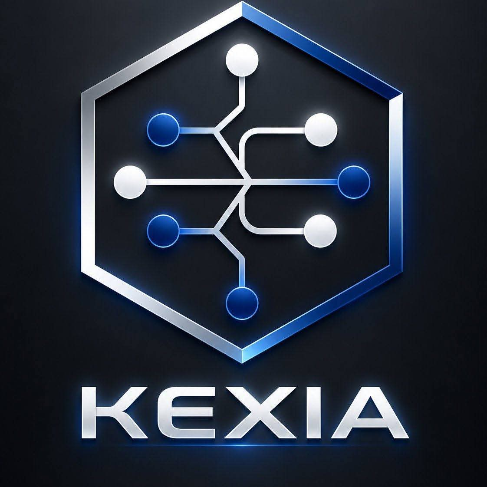

### Artificial Intelligence · Research · Engineering

**Engineering Intelligence. Advancing Possibilities.**

*Researching, designing, and developing intelligent technologies that connect advanced AI with real-world challenges.*

---

## About Kexia

**Kexia** is an artificial intelligence research and engineering initiative focused on exploring, building, and applying intelligent computational systems. Our work connects machine learning, language technologies, computer vision, robotics, and scientific computing.

We aim to translate technical research into reliable, practical solutions—approaching each challenge with scientific rigor, thoughtful engineering, and a commitment to responsible innovation.

## Research & Engineering Areas

| Area | Focus |
| :--- | :--- |
| **Large Language Models** | Language model development, adaptation, evaluation, and AI-powered agents. |
| **Machine Learning** | Predictive modeling, deep learning, experimentation, and data-driven systems. |
| **Computer Vision** | Image and video analysis, visual detection, and intelligent perception. |
| **Robotics & Autonomous Systems** | Intelligent agents, robotic perception, and autonomous-system prototyping. |
| **Computational Science** | AI-assisted analysis, simulation, and computational research workflows. |
| **Applied AI Engineering** | Prototypes and integrations that bring models into real-world applications. |

## What We Build

Our research and development interests span several complementary disciplines:

- **Language intelligence:** domain-oriented LLMs, model evaluation, and intelligent assistants.
- **Visual intelligence:** computer vision pipelines for detection, monitoring, and scene understanding.
- **Intelligent machines:** robotics, sensing, and autonomous-system experimentation.
- **AI for scientific discovery:** computational biology, predictive research, and simulation-oriented tools.
- **AI systems engineering:** reproducible experimentation, model integration, and practical deployment workflows.

> **Public repository note:** The projects published here represent selected work that can be shared openly. Some research, models, datasets, and client-facing implementations may remain private for intellectual-property, confidentiality, or licensing reasons.

## Technology & Methods

`Python` · `PyTorch` · `Transformers` · `Machine Learning` · `Deep Learning` · `Computer Vision` · `Model Evaluation` · `Scientific Computing`

*Specific tools and architectures vary by project.*

## Explore Our Work

Visit the [Repositories tab](../../repositories) to explore publicly available code, experiments, documentation, and technical resources as they are released.

We encourage every public project to include its scope, setup instructions, limitations, license, and reproducibility notes.

## Engineering Principles

- **Research-driven:** start with clear questions, measurable objectives, and evidence.
- **Reproducible:** document methodology, evaluation, and relevant limitations.
- **Responsible:** consider safety, privacy, security, and appropriate use.
- **Practical:** design with maintainability, reliability, and real-world needs in mind.
- **Collaborative:** value interdisciplinary work and constructive technical exchange.

## Collaboration

We welcome relevant discussions with researchers, engineers, academic groups, and organizations interested in applied artificial intelligence.

For collaboration inquiries, please use the official contact information provided on this GitHub organization's profile.

---

**KEXIA**  
*Artificial Intelligence · Research · Engineering*

Based in Guanajuato, Mexico · Built for a connected world

